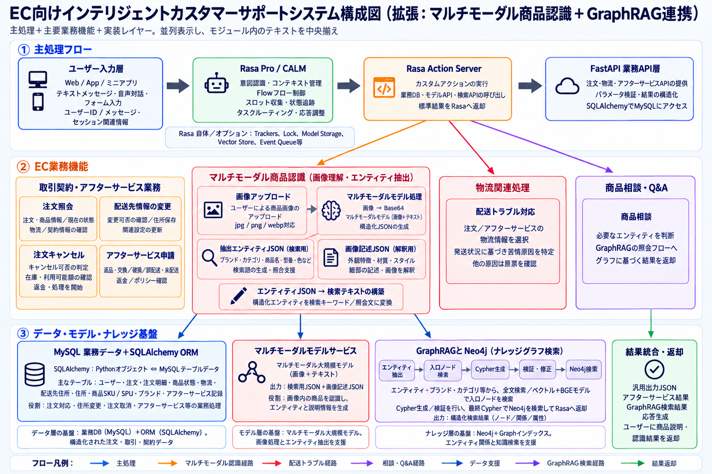

# ECS

## システム構成図



## プロジェクト概要

本プロジェクトは、ECサイト向けのインテリジェントカスタマーサポートシステムです。ユーザーの購買に伴う注文照会、配送先住所の変更、注文キャンセル、アフターサービス申請、配送に関する苦情、商品相談、商品画像の認識などに対応します。

Rasa Pro / CALMを対話管理とタスク制御の中核とし、Rasa Action Serverからバックエンドの業務API、機械学習モデルAPI、GraphRAG検索APIを呼び出します。これにより、複数ターンの対話における意図認識、スロット収集、タスクルーティング、結果の返却を実現します。バックエンドの業務データはFastAPI、MySQL、SQLAlchemy ORMで一元管理し、知識検索にはGraphRAGとNeo4jによる商品ナレッジグラフを使用します。

## 主な機能

### 1. 注文・アフターサービス対応

ECのカスタマーサポートでよく利用される、以下の注文関連業務に対応します。

- 注文照会
- 商品明細の照会
- 配送先情報の照会
- 配送先住所の変更
- 注文キャンセル
- アフターサービス申請
- アフターサービスの申請理由の選択と処理

この機能では主にMySQLの業務データベースを使用し、FastAPIを通じてデータの照会、変更、ステータス更新を行います。

### 2. 配送に関する苦情への対応

ユーザーは注文の配送状況に関する苦情を申し出ることができます。システムは選択された注文と配送情報を基に、苦情の重要度分類モデルで深刻度を判定し、対応結果を返します。

分類モデルは、苦情を以下の3段階に分類します。

- low（低）
- medium（中）
- high（高）

このモデルは、苦情対応の優先順位の判断を支援し、対応効率の向上に役立てます。

### 3. 商品相談・Q&A

商品、ブランド、カテゴリ、属性などについて、自然言語で問い合わせることができます。

商品関連の質問を受けると、システムはGraphRAGの検索フローに移行します。エンティティ抽出、入口ノード検索、Cypherクエリ生成、検証・修正、Neo4j検索を経て、構造化された商品相談の結果を生成します。

### 4. マルチモーダル商品認識

商品画像を使用したマルチモーダル認識機能を追加しています。ユーザーがアップロードした画像をBase64形式に変換し、マルチモーダルモデルに渡して分析します。

マルチモーダルモデルは、以下の2種類のJSONを生成します。

#### 検索用エンティティJSON

GraphRAG検索に使用し、主に以下の情報を含みます。

- ブランド
- 商品カテゴリ
- 商品名
- 型番
- 色
- 主要な属性

#### 画像記述JSON

モデルの判断根拠を説明するために使用し、主に以下の情報を含みます。

- 外観の特徴
- 材質やスタイルの説明
- 色の特徴
- 細部の説明
- 判断根拠
- 信頼度に関する情報

その後、検索用エンティティJSONを検索テキストに変換し、既存のGraphRAGモジュールに渡します。GraphRAGは抽出されたエンティティを基にナレッジグラフを検索します。検索結果と画像記述JSONの判断根拠を統合し、最終的に商品認識の結果をユーザーに返します。

## システムアーキテクチャ

システム全体は、以下の3つの層で構成されます。

1. **主処理フロー**

   ユーザー入力層、Rasa Pro / CALM、Rasa Action Server、FastAPI業務API層。

2. **ECカスタマーサポート業務機能層**

   注文・配送・アフターサービス業務、配送に関する苦情への対応、商品相談・Q&A、マルチモーダル商品認識。

3. **データ・モデル・ナレッジ基盤層**

   MySQL業務データベース、SQLAlchemy ORM、苦情の重要度分類モデル、マルチモーダルモデルサービス、GraphRAG、Neo4jナレッジグラフ。

## 技術スタック

- Python
- Rasa Pro / CALM
- Rasa Action Server
- FastAPI
- MySQL
- SQLAlchemy
- Neo4j
- GraphRAG
- マルチモーダル大規模言語モデル
- Base64画像エンコーディング
- 機械学習による分類モデル

## ディレクトリ構成

```text
ECS
├── ComplaintLevel        # 配送に関する苦情の重要度分類モデル
├── fine_tune             # モデルのファインチューニング関連ファイル
├── images                # システム画像・商品画像・構成図
│   └── architecture_ja.png  # 日本語版システム構成図
├── rasa                  # Rasa対話システム関連ファイル
├── web                   # フロントエンドページ・Web入力層
├── README.md             # プロジェクト説明
├── complaint_level_experiment_report.txt
└── start.bat             # 起動スクリプト
```
