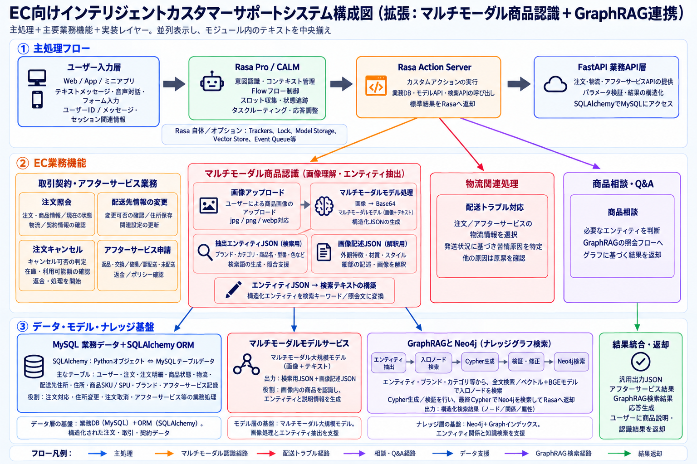

[ECS_README.md](https://github.com/user-attachments/files/34741547/ECS_README.md)
# ECS — EC向けインテリジェントカスタマーサポートシステム

Rasa Pro・GraphRAG（Neo4j）・LLMを組み合わせた、ECサイト向けの問い合わせ対応システムです。

- **開発体制・期間**：個人開発（約6か月）
- **主な成果**
  - Cypherの`EXPLAIN`検証通過率：**78% → 90%**（100件、LLMによる検証・修正の導入前後）
  - RAGAS（100問）：検索結果の関連性 **0.75 → 0.86**、回答の忠実度 **0.84 → 0.92** ほか、全4指標が向上
  - 苦情の重要度分類（3クラス）：BERTで**正解率95.1%**（RandomForest 75.0%、fastText 86.4%）

## システム構成図



## プロジェクト概要

本プロジェクトは、ECサイト向けのインテリジェントカスタマーサポートシステムです。ユーザーの購買に伴う注文照会、配送先住所の変更、注文キャンセル、アフターサービス申請、配送に関する苦情、商品相談、商品画像の認識などに対応します。

Rasa Pro / CALMを対話管理とタスク制御の中核とし、Rasa Action Serverからバックエンドの業務API、機械学習モデルAPI、GraphRAG検索APIを呼び出します。これにより、複数ターンの対話における意図認識、スロット収集、タスクルーティング、結果の返却を実現します。バックエンドの業務データはFastAPI、MySQL、SQLAlchemy ORMで一元管理し、知識検索にはGraphRAGとNeo4jによる商品ナレッジグラフを使用します。

## 主な機能

### 1. 注文・アフターサービス対応

ECのカスタマーサポートでよく利用される、以下の注文関連業務に対応します。

- 注文照会
- 商品明細の照会
- 配送先情報の照会
- 配送先住所の変更
- 注文キャンセル
- アフターサービス申請
- アフターサービスの申請理由の選択と処理

この機能では主にMySQLの業務データベースを使用し、FastAPIを通じてデータの照会、変更、ステータス更新を行います。

### 2. 配送に関する苦情への対応

ユーザーは注文の配送状況に関する苦情を申し出ることができます。システムは選択された注文と配送情報を基に、苦情の重要度分類モデルで深刻度を判定し、対応結果を返します。

分類モデルは、苦情を以下の3段階に分類します。

- low（低）
- medium（中）
- high（高）

このモデルは、苦情対応の優先順位の判断を支援し、対応効率の向上に役立てます。

学習7,000件・検証2,000件・テスト1,000件のデータセット（3クラスほぼ均等）で、ベースラインと比較しました。テストデータでの結果は以下のとおりです（詳細は[実験レポート](complaint_level_experiment_report.txt)）。

| モデル | Accuracy | F1 |
|---|---:|---:|
| Random Forest | 0.750 | 0.749 |
| fastText | 0.864 | 約0.864 |
| **BERT（ファインチューニング）** | **0.951** | **0.951** |
| DistilBERT（蒸留モデル） | 0.920 | 0.920 |

### 3. 商品相談・Q&A

商品、ブランド、カテゴリ、属性などについて、自然言語で問い合わせることができます。

商品関連の質問を受けると、システムはGraphRAGの検索フローに移行します。エンティティ抽出、入口ノード検索、Cypherクエリ生成、検証・修正、Neo4j検索を経て、構造化された商品相談の結果を生成します。

### 4. マルチモーダル商品認識

商品画像を使用したマルチモーダル認識機能を追加しています。ユーザーがアップロードした画像をBase64形式に変換し、マルチモーダルモデルに渡して分析します。

マルチモーダルモデルは、以下の2種類のJSONを生成します。

#### 検索用エンティティJSON

GraphRAG検索に使用し、主に以下の情報を含みます。

- ブランド
- 商品カテゴリ
- 商品名
- 型番
- 色
- 主要な属性

#### 画像記述JSON

モデルの判断根拠を説明するために使用し、主に以下の情報を含みます。

- 外観の特徴
- 材質やスタイルの説明
- 色の特徴
- 細部の説明
- 判断根拠
- 信頼度に関する情報

その後、検索用エンティティJSONを検索テキストに変換し、既存のGraphRAGモジュールに渡します。GraphRAGは抽出されたエンティティを基にナレッジグラフを検索します。検索結果と画像記述JSONの判断根拠を統合し、最終的に商品認識の結果をユーザーに返します。

## GraphRAGの評価（RAGAS）

GraphRAGの検索結果と最終回答を評価するため、[RAGAS評価スクリプト](evaluation/ragas_evaluate.py)を実装しています。外部のJSONL形式の実行記録から、質問、検索結果、実際に生成された回答、人手で確認した参照回答を読み込み、評価用LLMで採点します。

評価には、以下の4つの情報を使用します。

- `user_input`：ユーザーの質問。
- `retrieved_contexts`：Cypher実行後にNeo4jから取得し、実際に回答モデルへ渡した商品情報のテキストリスト。
- `response`：システムが実際に生成した最終回答。
- `reference`：データベースの内容を基に人手で確認した参照回答。

入口ノードの候補やCypherの文字列ではなく、回答の根拠として使用した検索結果を評価対象とします。

| 評価指標 | 評価内容 |
|---|---|
| Context Precision | 参照回答に照らして有用な検索結果が上位に並んでいるか。 |
| Context Recall | 参照回答に必要な情報が検索結果に含まれているか。 |
| Faithfulness | 最終回答の内容が検索結果によって裏付けられているか。 |
| Factual Correctness | 最終回答と参照回答の事実が整合しているか。文字列の完全一致ではなく、事実の重なりをF1で評価します。 |

サンプルごとのスコアをCSV、各指標の平均スコアをJSONに保存します。Cypherの実行成功率や注文操作の成否は、このスクリプトの評価対象には含まれません。

### 評価結果

100問のテストセットで、検索・生成の改善前後を比較しました。

| 評価指標 | 内容 | 改善前 | 改善後 |
|---|---|---:|---:|
| Context Precision | 検索結果の関連性 | 0.75 | **0.86** |
| Context Recall | 必要情報の十分性 | 0.77 | **0.89** |
| Faithfulness | 回答の忠実度 | 0.84 | **0.92** |
| Factual Correctness | 正解との一致度 | 0.76 | **0.87** |

指標ごとに見ることで、問題が「検索側」か「生成側」かを切り分け、改善につなげました。テストデータと評価出力はリポジトリに含めません。

## Cypherの検証通過率

[Cypher検証スクリプト](evaluation/cypher_evaluate.py)で、生成されたクエリがNeo4jの`EXPLAIN`による構文・実行計画の確認を通過するかを評価します。外部JSONLの元のクエリと、存在する場合は修正後のクエリを検証します。スクリプト自体はクエリの生成や修正を行いません。

| 指標 | 計算方法 |
|---|---|
| 初回検証通過率 | 元のクエリが検証を通過した件数 ÷ 全サンプル数。 |
| 最終検証通過率 | 修正後のクエリ（修正がない場合は元のクエリ）が検証を通過した件数 ÷ 全サンプル数。 |
| 修正成功率 | 初回検証に失敗し、修正後に検証を通過した件数 ÷ 修正を試みた件数。修正を試みたサンプルがなければ未定義として保存します。 |

個別の検証結果とエラーコードをCSV、件数と通過率をJSONに保存します。認証・権限・接続などの異常は、クエリの検証失敗とは区別します。`EXPLAIN`はクエリを実行しないため、これらの指標は実行成功率やユーザーの意図に対する正解率を示すものではありません。

### 評価結果

100件のテストで、LLMによる検証・修正の導入前後を比較しました。

| 指標 | 導入前 | 導入後 |
|---|---:|---:|
| `EXPLAIN`検証通過率 | 78%（78/100件） | **90%（90/100件）** |

初回の検証に失敗した22件のうち12件が、エラー情報を使った修正で通過しました。テストデータと評価出力はリポジトリに含めません。

## 意図認識LLMのLoRA微調整

実際のユーザー発話に対応するFlowのトリガーを付与し、言い換え・表現拡張で学習データを作成しました。[学習スクリプト](fine_tune/src/train.py)では、Qwen2.5-3B-InstructをLoRA（r=16、lora_alpha=32、lora_dropout=0.05、3エポック）でファインチューニングしています。

## システムアーキテクチャ

システム全体は、以下の3つの層で構成されます。

1. **主処理フロー**

   ユーザー入力層、Rasa Pro / CALM、Rasa Action Server、FastAPI業務API層。

2. **ECカスタマーサポート業務機能層**

   注文・配送・アフターサービス業務、配送に関する苦情への対応、商品相談・Q&A、マルチモーダル商品認識。

3. **データ・モデル・ナレッジ基盤層**

   MySQL業務データベース、SQLAlchemy ORM、苦情の重要度分類モデル、マルチモーダルモデルサービス、GraphRAG、Neo4jナレッジグラフ。

## 技術スタック

- Python
- Rasa Pro / CALM
- Rasa Action Server
- FastAPI
- MySQL
- SQLAlchemy
- Neo4j
- GraphRAG
- RAGAS
- LLM：Doubao（OpenAI互換APIで接続。モデルは環境変数で切り替え可能）
- LoRA（Qwen2.5-3B-Instruct）
- BERT / fastText / Random Forest
- マルチモーダル大規模言語モデル
- Base64画像エンコーディング
- 機械学習による分類モデル

## ディレクトリ構成

```text
ECS
├── ComplaintLevel        # 配送に関する苦情の重要度分類モデル
├── evaluation            # 検索・回答とCypherの評価コード
│   ├── cypher_evaluate.py # Cypherの構文・実行計画の検証
│   └── ragas_evaluate.py
├── fine_tune             # モデルのファインチューニング関連ファイル
├── images                # システム画像・商品画像・構成図
│   └── architecture_ja.png  # 日本語版システム構成図
├── rasa                  # Rasa対話システム関連ファイル
├── web                   # フロントエンドページ・Web入力層
├── README.md             # プロジェクト説明
├── complaint_level_experiment_report.txt
└── start.bat             # 起動スクリプト
```

## 実行方法

### 前提

- Python環境（Rasa Proが動作するもの。Rasa Proのライセンスキーは環境変数`RASA_PRO_LICENSE`で設定）
- MySQL（注文・配送・アフターサービスの業務データ）
- Neo4j（商品ナレッジグラフ）
- OpenAI互換APIで利用できるLLM

### 設定

接続情報はリポジトリに含めていません。以下を各自の環境で用意してください。

| ファイル・環境変数 | 内容 |
|---|---|
| `.env` | `OPENAI_API_KEY1` / `OPENAI_BASE_URL1` / `OPENAI_MODEL1`：GraphRAG用LLM<br>`OPENAI_API_KEY2` / `OPENAI_BASE_URL2` / `OPENAI_MODEL2`：画像認識用マルチモーダルモデル<br>`NEO4J_URI` / `NEO4J_USERNAME` / `NEO4J_PASSWORD` |
| `rasa/endpoints.yml` | Rasa ProのLLM・Embeddingのモデルグループ、Action Serverの設定 |
| `rasa/actions/db.py` | MySQLの接続設定 |

### 起動

`start.bat`内の`PYTHON_EXE`を自分の環境のPythonに変更してから実行します。以下の4つのサービスが起動します。

| サービス | コマンド | ポート |
|---|---|---|
| Rasa Core | `python -m rasa run --enable-api`（`rasa/`で実行） | 5005 |
| Rasa Action Server | `python -m rasa run actions`（`rasa/`で実行） | 5055 |
| FastAPI（Web画面・API） | `python -m uvicorn web.main:app --port 8000` | 8000 |
| Embeddingサービス | `python -m uvicorn embed_service:app --port 10010`（`rasa/addons/`で実行） | 10010 |

起動後、ブラウザで http://localhost:8000 を開くとチャット画面を利用できます。

### 評価スクリプト

```bash
# RAGAS評価（評価用LLMは RAGAS_EVAL_API_KEY / RAGAS_EVAL_BASE_URL / RAGAS_EVAL_MODEL で指定）
python evaluation/ragas_evaluate.py --input <実行記録.jsonl> --output-dir evaluation/results

# Cypherの検証通過率（NEO4J_URI / NEO4J_PASSWORD が必要）
python evaluation/cypher_evaluate.py --input <クエリ記録.jsonl> --output-dir evaluation/results/cypher
```
